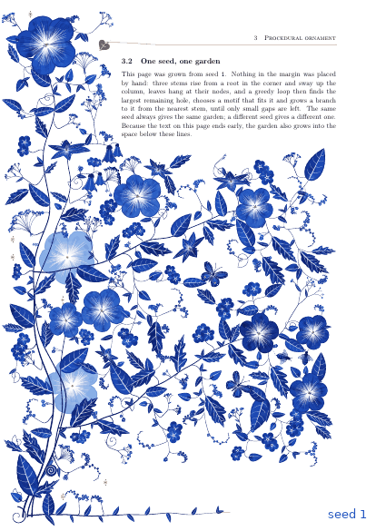
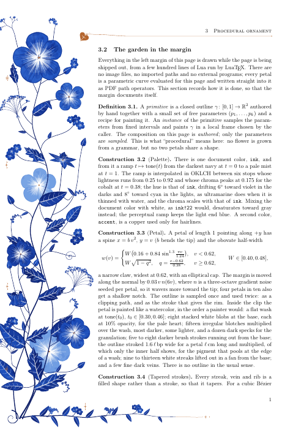
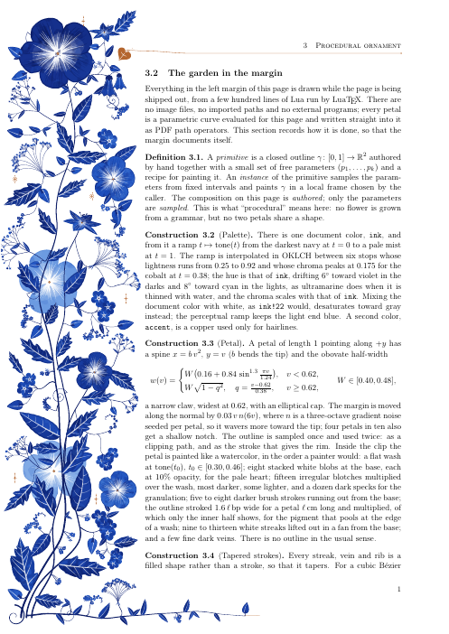
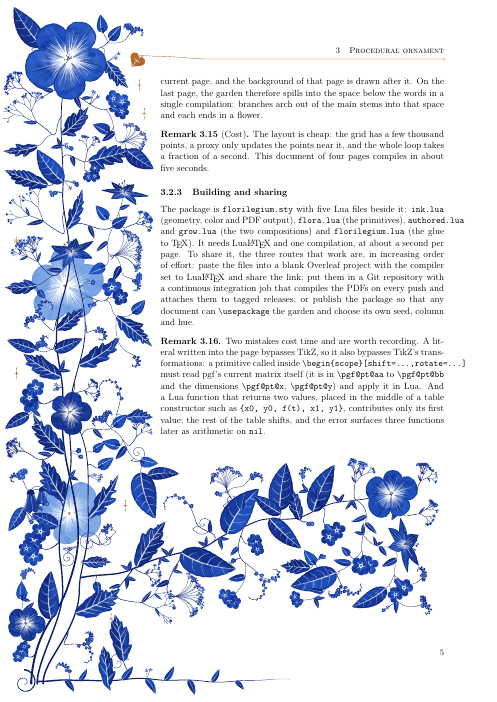

# florilegium

## Origin

The [Reddit post](https://www.reddit.com/r/LaTeX/comments/1xixznw/how_do_you_make_these_flowers_in_latex/)
asked how to make flowers like these in LaTeX. I don't know how the original was made, and
this project doesn't try to reproduce it. It is one possible way, and the way I did it:
hand-authored primitives with randomized parameters, painted in Lua, placed by a procedural
layout whose "fill the unused space" part borrows a 1998 idea from the ornament literature.
It gets a similar look.

## What it is

Procedurally generated Delft-blue floral page margins for LaTeX. No images, no imported
paths, no external assets: every petal, leaf and stem is a parametric curve computed in Lua
while the page is being written, painted like a watercolor, and written straight into the
PDF. Every page gets its own garden.



*Six seeds of the grown composition. Same code, different seed — and the garden fills
whatever space the text leaves free.*

Two documents share one package:

| | `florilegium.tex` | `florilegium-grow.tex` |
|---|---|---|
| composition | **authored**: stems, leaves and flowers placed by hand, every parameter sampled | **grown**: a plant grown to fit the page by a greedy space-filling loop |
| adapts to | nothing (tuned for A4, 68 mm margin) | the page layout, and the free space below the text on the last page |
| preview |  |  |

Both PDFs are self-describing: the body text is the write-up of how the margin is drawn.



*Last page of the grown document: the text ends early, so branches arch into the space below.*


*300 dpi crop. Mottled washes with white streaks lifted out, lobed leaves with white veins,
forget-me-not cymes, a pale ghost flower behind the stems.*

## Build

LuaLaTeX, one pass, about a second a page.

```sh
make                        # both PDFs
make seed-7                 # one page from seed 7 -> build/seed-7.pdf
make gallery SEEDS="1 2 3"  # gallery/seeds.png + seeds.gif (python3, Pillow, pdftoppm)
```

No TeX installed? Build the image once and run everything in it:

```sh
docker build -t florilegium-tex tools
make RUN=tools/in-docker
```

Or paste `florilegium.sty`, the five `.lua` files and one of the `.tex` files into an
[Overleaf](https://www.overleaf.com) project and set the compiler to LuaLaTeX.

Use it in your own document:

```latex
\usepackage[grown]{florilegium}      % or plain \usepackage{florilegium} for the authored one
\definecolor{ink}{HTML}{5B2A1F}      % optional: the hue of the whole palette (this is sepia)
\definecolor{accent}{HTML}{B4662F}   % optional: the copper of the hairlines
...
\florilegiumtextend                  % grown only: at the very end of the text
```

A fixed seed instead of the page number: `lualatex "\def\florilegiumseed{7}\input{florilegium-grow.tex}"`.

Any primitive can be drawn on its own inside a TikZ picture, under the current scope's
shift, rotation and scale:

```latex
\begin{tikzpicture}
  \begin{scope}[shift={(2,2)},rotate=20]\florilegiumdraw{flower}{1.3}\end{scope}
  \begin{scope}[shift={(5,0)}]\florilegiumdraw{leaf}{3.0, {depth=0.6}}\end{scope}
  \begin{scope}[shift={(8,1)}]\florilegiumdraw{ghost}{"lily", {s=1.4}}\end{scope}
\end{tikzpicture}
```

## How it works

**Drawing** (`ink.lua`). All geometry is computed in Lua and written as PDF path operators
into one literal node per page; TeX does no arithmetic. Primitives are drawn in a local
frame under an affine transform, which is read from TikZ when a primitive is called inside
a scope. Colors come from a tone ramp derived from the one document color `ink`: navy to
mist at the hue of `ink`, interpolated in OKLCH so the light end stays blue instead of
turning gray. Tapered strokes are two offset Béziers, not sampled ribbons.

**Primitives** (`flora.lua`). Painted in the order a watercolorist would: a flat wash,
darker blotches multiplied over it, pigment pooling at the edges, streaks lifted out in
white, a few fine veins, and almost no outlines. Broad petals and flowers, star lilies seen
at a tilt, blossoms and florets, buds and bellflowers; lobed and entire leaves; forget-me-not
cymes that curl like a scorpion's tail, branching sprigs, umbels, tendrils; copper sparkles,
rosettes and the ivy-leaf fleuron whose stem becomes the head rule. Any of them can be
painted as a pale ghost.

**Authored composition** (`authored.lua`). A plant grows from a root in the bottom-left
corner: three stems through hand-picked control points, a fourth along the bottom of the
page as the footer, leaves at chosen fractions of the stems, and every other motif on a
branch that leaves its stem tangentially and arrives along the motif's axis — so every
flower can be traced back to the root.

**Grown composition** (`grow.lua`), in the spirit of Wong, Zongker & Salesin,
[*Computer-Generated Floral Ornament*](https://dl.acm.org/doi/10.1145/280814.280948)
(SIGGRAPH 1998). The stems sway up the column as smooth noise of their height; leaves are
hung at their nodes where there is room. Then, repeatedly: take the largest free disc within
reach of a stem, choose a motif that fits it, and grow a branch to it from the nearest stem
point; the branch becomes a stem in turn. Big holes are taken first, so flowers and lilies
land early, sprays and leaves fill the middle, and the loop ends by tucking leaflets, buds
and florets onto the stems. The end of the text is measured with `\pagetotal` in the same
pass, so a short last page grows branches into the space below it with one compilation.

**Procedural ≠ random.** The seed is derived from the page number, so page *n* always
gets garden *n*. Reproducibility is what makes the document stable enough to typeset.

See [CLAUDE.md](CLAUDE.md) for a handoff-style map of the code, the tunables, and ideas not
yet done.

## License

MIT.
