# florilegium

[](https://github.com/kevinraymond/florilegium/actions/workflows/build.yml)
[](https://kevinraymond.github.io/florilegium/)
[](https://github.com/kevinraymond/florilegium/releases/latest)
[](https://ctan.org/pkg/florilegium)
[](LICENSE)
[](https://scorecard.dev/viewer/?uri=github.com/kevinraymond/florilegium)

Procedurally generated Delft-blue page margins for LaTeX, their plants, visitors, shells and
Gothic tracery sampled from genomes. No images, no imported paths, no external assets: every
petal, leaf, stem, whorl and arch is a curve computed while the page is being written, painted like a
watercolor, and written straight into the PDF. Every page grows a garden of its own, and each
document's seed its own plants.

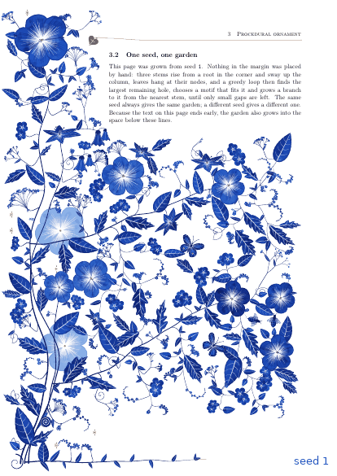

*Six seeds of the grown margin. Same code, different seed, and the garden fills whatever space
the text leaves free.*

**[Try it in your browser](https://kevinraymond.github.io/florilegium/)** ·
[download the package and the PDFs](https://github.com/kevinraymond/florilegium/releases/latest) ·
[on CTAN](https://ctan.org/pkg/florilegium) ·
[documentation](#documentation)

## Origin

The [Reddit post](https://www.reddit.com/r/LaTeX/comments/1xixznw/how_do_you_make_these_flowers_in_latex/)
asked how to make flowers like these in LaTeX. I don't know how the original was made. This
project is one possible way. The way I did it first, in 1.3, uses hand-authored primitives with
randomized parameters, painted in Lua and placed by a procedural layout whose "fill the unused
space" part borrows a 1998 idea from the ornament literature. In 2.0 the plants and animals of
the grown margin are sampled from genomes of botanical traits, so what grows is procedural too,
not only where it grows. It gets a similar look, but I explicitly tried to not replicate the
original.

This project was made with the assistance of AI (Claude), and I'm sharing the
[process I used](PROCESS.md) to bring it to life.

## Quick start

With LuaLaTeX, put `florilegium.sty` and the `florilegium*.lua` files beside your document (or
upload them to an [Overleaf](https://www.overleaf.com) project set to LuaLaTeX). They are all in
[`florilegium.zip`](https://github.com/kevinraymond/florilegium/releases/latest/download/florilegium.zip),
with the TikZ library and the manual:

```latex
\usepackage[a4paper,left=68mm,right=22mm]{geometry}   % a wide margin for the garden
\usepackage[grown,sections]{florilegium}              % flowers at the headings, too
\definecolor{ink}{HTML}{5B2A1F}                       % optional: any hue (this is sepia)
...
\florilegiuminitial[4]{T}his paragraph starts with a decorated T.
\florilegiumtextend                                   % at the very end: fill the space below
```

With pdfLaTeX, or in any TikZ picture, the TikZ library draws the same species in pure TikZ
(it needs only its two `tikzlibraryflorilegium*.code.tex` files):

```latex
\usepackage{tikz}
\usetikzlibrary{florilegium}
\begin{tikzpicture}
  \pic {florilegium plants={plants={3/rose, 17/umbellifer, 29/mustard}, size=21cm, width=6cm}};
\end{tikzpicture}
```

Under pdfLaTeX a strip this tall needs more memory than pdfTeX has by default; run it as
`extra_mem_top=10000000 pdflatex doc.tex` ([pdfLaTeX's memory](docs/tikz.md#pdflatexs-memory)).

[Using the package](docs/usage.md) lists every option and command.

## The documents

| | `florilegium-grow.tex` | `florilegium.tex` |
|---|---|---|
| composition | **grown**: plants grown to fit the page by a greedy space-filling loop | **authored**: stems, leaves and flowers placed by hand, every parameter sampled |
| adapts to | the page layout, and the free space below the text on the last page | nothing (tuned for A4, 68 mm margin) |
| preview | 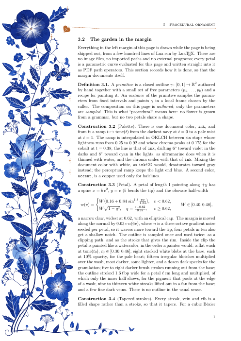 | 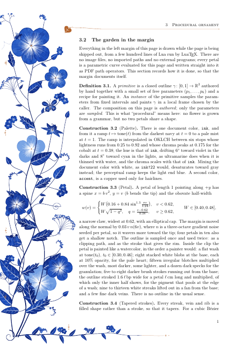 |
| PDF | [florilegium-grow.pdf](https://github.com/kevinraymond/florilegium/releases/latest/download/florilegium-grow.pdf) | [florilegium.pdf](https://github.com/kevinraymond/florilegium/releases/latest/download/florilegium.pdf) |

Both are self-describing: their body text is the write-up of how the margin is drawn.
[`showcase.tex`](https://github.com/kevinraymond/florilegium/releases/latest/download/showcase.pdf)
shows what the margin does with a document's text, and
[`spread.tex`](https://github.com/kevinraymond/florilegium/releases/latest/download/spread.pdf)
two-sided pages.

## Watch it grow

| as it grows | with the free space it fills |
|---|---|
| 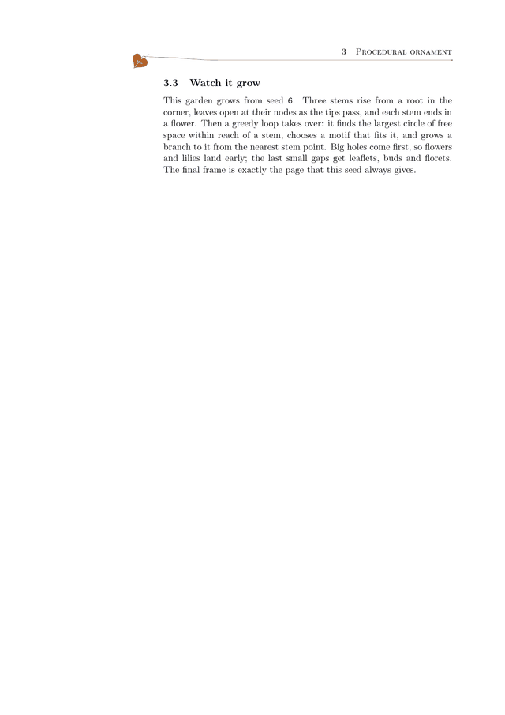 | 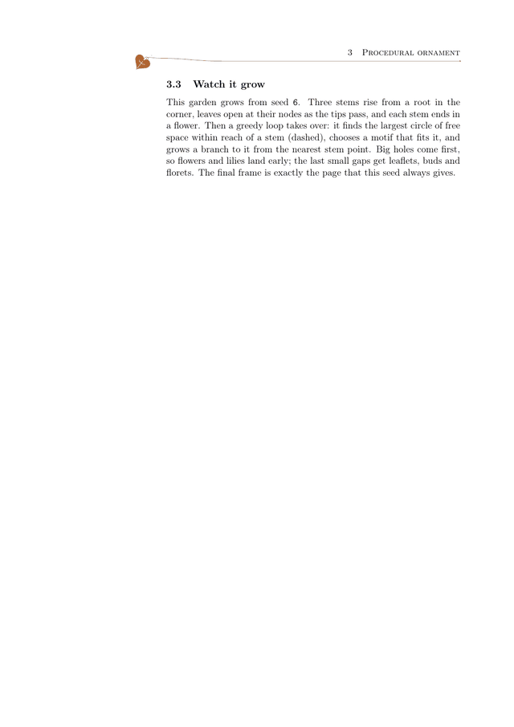 |

*Seed 6, from an empty margin to the finished page. The stems rise first, leaves open as the
tips pass their nodes, and each stem ends in a flower. Then the greedy loop takes over: on the
right, each dashed circle is the largest free disc it found, just before a branch grows to it.
Big holes come first, small ones last. The visitors fly in along the way, each to a hole of its
own, and the last frame is exactly the page this seed always gives.*

[How it works](docs/how-it-works.md) follows the loop step by step.

## Plants from genomes

| three plants on one root, twice | every flower form, as its plant holds it |
|---|---|
|  |  |

Each plant in a grown margin is a species, 62 traits sampled in a fixed order from one of
fifteen body plans, from the visitor its flowers are for to its flower, its cluster, its leaf
and its fruit. A body plan keeps botany's rules, so a lily has its parts in threes and a pea
flower is two-sided with a pod. A document gets eight species and each page grows four, so
they recur through the document the way plants recur through a garden. Each species can
describe itself:

> A blue wheel of five lobes in a coiled cyme that uncurls, for bees; hairy, smooth-edged, oval
> leaves; then nutlets.
>
> A blue pea flower along a raceme, for bees; leaves of five pairs of smooth-edged leaflets,
> climbing by tendrils; then pods.

[The species garden](docs/species.md) describes the genome and how a page chooses its plants.
Any of its traits can be fixed and the rest sampled, so a TikZ pic can grow a seven-leaflet
palmate leaf or a white rose ([your own genome](docs/tikz.md#a-genome-of-your-own),
[the traits](docs/traits.md)).

## Visitors


Visitors are sampled from genomes of their own, fifteen kinds from butterflies and hawkmoths to
ladybirds, caterpillars, snails and birds. Each plant brings the visitor its flowers are for, so
a bee flies in near a bee flower and a hummingbird near a red tube, while a snail climbs a stem
and a caterpillar eats a leaf of its own. About three come to a page; `novisitors` leaves them
out, and the plants grow into the room they would have taken.

## The margin reads the text

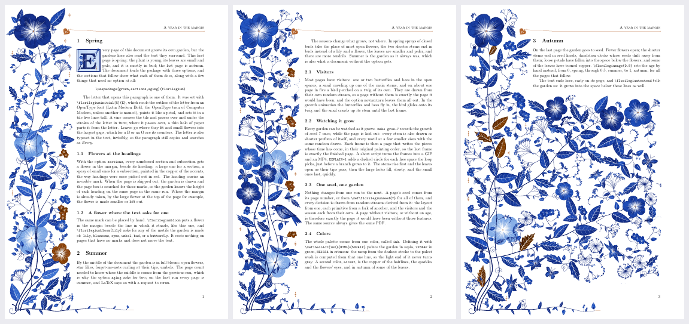

*`showcase.tex`, "A year in the margin": spring on the first page, summer, autumn on the last.*

A paragraph can open with a decorated initial, the letter's outline read from a font and wound
with a vine that passes over and under its strokes. Every numbered section and subsection can
get a flower beside it in copper, the way headings were once picked out in red, and
`\florilegiumbloom` puts one beside any line. With the option `aging`, the garden ages from
buds on the first page to fruit and seed heads on the last.
[Using the package](docs/usage.md#the-margin-reads-the-text) has the details.

## Gothic tracery

| a headpiece over a section, the margin's vine up its jamb | windows of every period, in TikZ |
|---|---|
|  |  |

A window of Gothic tracery is sampled from a genome of its own, the way a plant is. Its
period comes first and sets the arch, how the head branches, the figures and their foils, the
cusps, the orders and the hood. With the option `headpieces` every section gets one, a screen
of lights under a flat arch. The garden sends a branch to it, and a vine twines up the jamb
with the leaves of the nearest plant. The same windows are TikZ pics. An initial can open
under a cusped arch, and an ornament can be a trefoil, a quatrefoil or a rose.

```latex
\usepackage[grown,headpieces]{florilegium}
\pic {florilegium tracery={seed=3, role=window, size=4cm, traits={period=curvilinear}}};
```

[Gothic tracery](docs/tracery.md) describes the genome, the headpiece and how a window is drawn.

## Shells

| shells on the ground at the foot of the plants | shells of every kind, in TikZ |
|---|---|
|  |  |

A shell is sampled from a genome too: an ammonite or a nautilus, five kinds of bivalve, three
sea snails or a cowrie, a coil drawn as David Raup's tube. Each document has a cabinet of four,
and on one page in three a few of them lie on the ground beside the root, under the footer's
vine. `theme=shells` fills the whole margin with them, among strands of wrack. The same shells
are TikZ pics.

```latex
\usepackage[grown,noshells]{florilegium}   % or no shells on the ground
\pic {florilegium shell={seed=3, role=ammonite, size=3cm}};
```

[Shells](docs/shells.md) describes the genome, where they lie and how each kind is drawn.

## In pure TikZ

The species don't need Lua. Under pdfLaTeX, `\usetikzlibrary{florilegium}` samples each plant,
visitor, window of tracery and shell from its genome, grows it and paints it with pgfmath and TikZ
alone, and each of the strips above is one `\pic`. It takes a minute and a half for a strip of three plants 21 cm
tall, and pdfTeX needs more memory than it has by default. Under LuaLaTeX, the same pics are drawn by
florilegium's Lua in under a second, within a fraction of a point of pure TikZ's drawing. Only
the margin itself, laid out around a page's text, is the package's and needs LuaLaTeX.

```latex
\pic {florilegium flower={seed=7, role=hero, size=2.6cm}};
\pic {florilegium inflorescence={seed=20, role=heath, scale=1.3, season=0.3}};   % in spring
\pic {florilegium visitor={seed=3, role=butterfly, size=3cm}};
```

[The TikZ library](docs/tikz.md) lists every pic and key.

## Themes

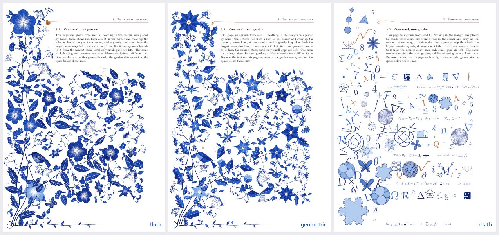

*Seed 6 four times: the species garden, with `theme=geometric`, with `theme=math` and with `theme=shells`.*

The growth loop never knew what it was drawing, so a theme can redraw it. `theme=geometric`
cuts v1.3's plant from flat, straight-edged shapes, with crystals among the flowers.
`theme=math` grows no plant at all, but figures, families of figures and equations that cascade
down the margin and across the foot of the page. `theme=shells` lays shells sampled from genomes
among strands of wrack, the document's cabinet of four low in the corner. [Themes](docs/themes.md)
shows all three, and how to write one.

## More in the margin

| | |
|---|---|
| 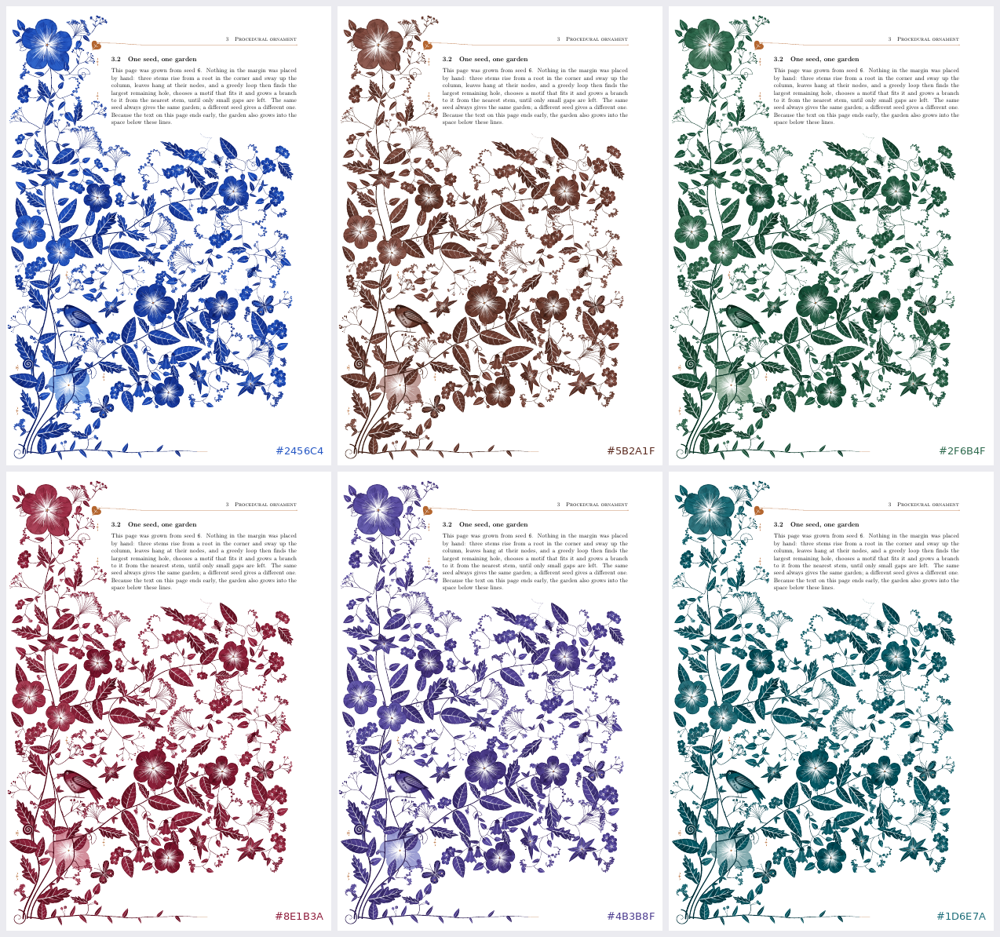 | 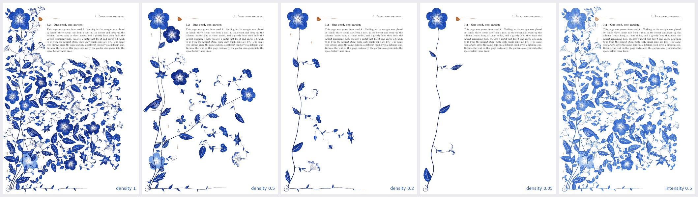 |
| *[Any ink](docs/usage.md#colors).* The whole palette comes from one color, computed in OKLCH so the pale end never turns gray. | *[Less in the margin](docs/usage.md#less-in-the-margin).* `density` grows less, down to a single vine; `intensity` paints paler. |
| 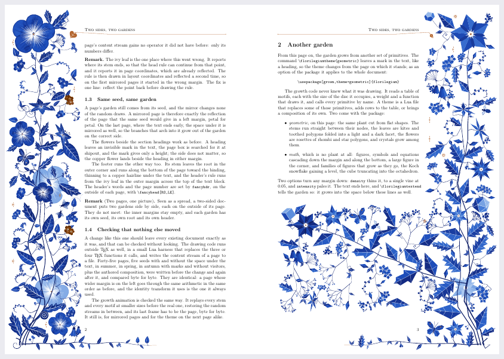 | 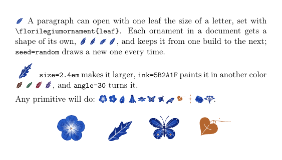 |
| *[Both sides of the page](docs/usage.md#both-sides-of-the-page).* The garden grows in the wider margin, mirrored on a right-hand page. | *[One ornament in the text](docs/usage.md#one-ornament-in-the-text).* `\florilegiumornament{leaf}` sets one shape in the line. |

## Without TeX

| SVG and the browser | PostScript |
|---|---|
| 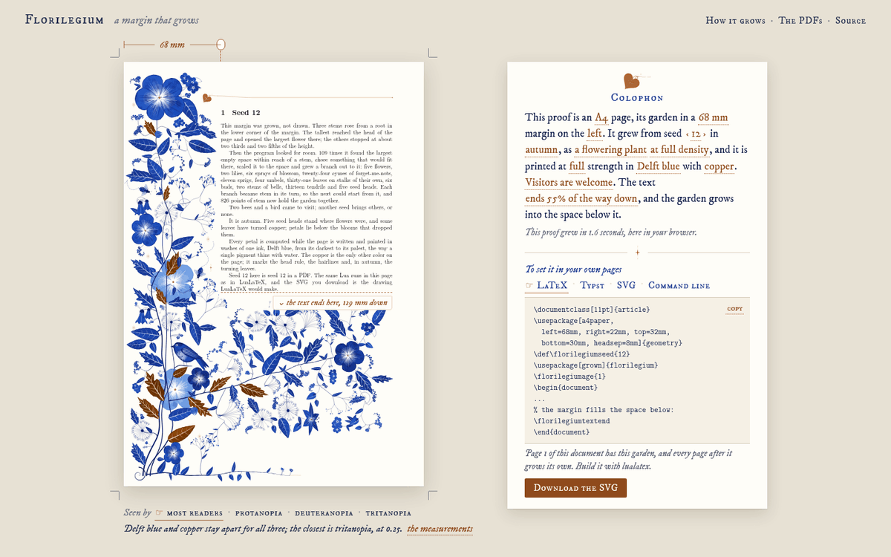 | 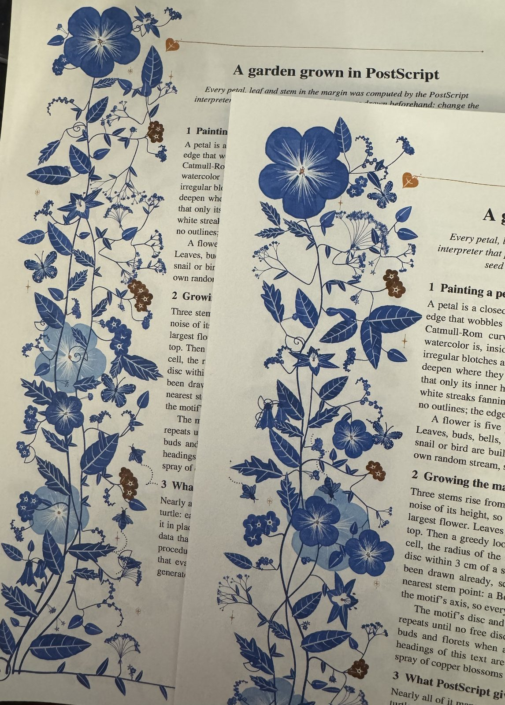 |
| `florilegium-svg.lua` runs the package's own Lua under any Lua 5.3 or 5.4 and writes the page as SVG, byte for byte the drawing LuaLaTeX would make, for Typst or any page background. The [playground](https://kevinraymond.github.io/florilegium/) runs it in the browser, set as a printer's proof whose colophon is the set of controls. | `postscript/florilegium.ps` grows v1.3's garden in PostScript, one self-contained file. Ghostscript or a printer computes every petal while it reads the page; sent twice to a printer with no seed, it prints two different gardens. |

[SVG, Typst and the browser](docs/svg-and-web.md) and [the PostScript port](postscript/README.md)
have the details.

## Ports and adaptations

Other people have taken the garden further. Each of these is its author's own project, kept in
its own repository, and follows the release named beside it; questions about one belong there.

| project | what it does | follows |
|---|---|---|
| [groeneveld/florilegiumTypst](https://github.com/groeneveld/florilegiumTypst) | a Typst package, the drawing code translated to Rust and run as a WebAssembly plugin, with a sumi-e plum style of its own | 1.1 |
| [Baldomo/florilegium-typst](https://github.com/Baldomo/florilegium-typst) | a second Typst package, also a Rust port run as a WebAssembly plugin | 2.0 |
| [wilsybubs/florilegium](https://github.com/wilsybubs/florilegium) | a fork that compiles with XeLaTeX as well | 1.1 |
| [jfoboss/florilegium](https://github.com/jfoboss/florilegium) | a JavaScript port that regrows the garden on an e-book's part-title pages, and a Claude skill (in Russian) that builds ePub, FB2 and MOBI books with it | 1.3 |
| [amberwhitehead/florilegium](https://github.com/amberwhitehead/florilegium) | a single web page, in plain JavaScript and SVG, that grows a garden around a poem you write | 1.1 |
| [funkhouserw/florilegium](https://github.com/funkhouserw/florilegium) | a fork with a cat gym theme and an oak theme, and [Felilegium](https://felilegium.corporateshill.com/), a web editor that grows them, a kelp forest or the flowers around text boxes you draw and exports PNG, PDF or HTML | 2.0 |

[tikz-flora](https://github.com/wn-mitch/tikz-flora) by wn-mitch is a LuaLaTeX package of its
own that grows watercolor flora in the margin, drawn through PGF, and names florilegium among
the projects it started from.

To build on florilegium from another tool, call `florilegium-svg.lua`. Its command line and the
options of its `page` function are what stays put from one release to the next, and they draw
the garden LuaLaTeX draws ([SVG, Typst and the browser](docs/svg-and-web.md)). The other files,
and the functions inside them, may be renamed or rewritten in any release, as 1.3 renamed every
module; each release's notes list the files it renamed or removed. Pin a port to a release tag.

## 1.3 and 2.0

Nothing in either release is an image: every shape is computed from a seed. What the code
decides is another matter. In 1.3 the margin is grown, but what grows in it comes from a fixed
set of *hand-designed kinds*, shapes written by hand (a flower, a lily, a leaf, a butterfly ...)
whose sizes and details are random. In 2.0 the grown margin's plants and animals are *species*
sampled from genomes, so each document's seed grows plants of its own, and the TikZ library
draws the same species on their own.

| page 2 of the grown document, 1.3 and 2.0 | up close at 600 dpi, 1.3 left and 2.0 right |
|---|---|
|  |  |

*The same page and seed in both releases. 2.0 paints its species with 1.3's washes, streaks and
veins, so what changes is what grows: daisies, star lilies, a fern at the root, and the visitors
those plants bring.*

| what | release | where things go | the plants and animals | drawn by |
|---|---|---|---|---|
| grown margin | 1.3 | **procedural**, grown into the free space | hand-designed kinds | Lua (LuaLaTeX) |
| grown margin | 2.0 | **procedural**, grown into the free space | **procedural** species from genomes | Lua (LuaLaTeX) |
| authored page | both | placed by hand | hand-designed kinds | Lua (LuaLaTeX) |
| geometric theme | both | **procedural**, grown | hand-designed kinds, cut flat | Lua (LuaLaTeX) |
| math theme | both | **procedural**, packed into the free space | figures computed from their mathematics, and TeX's equations | Lua and TeX (LuaLaTeX) |
| ornaments and initials | both | set in the text; an initial's vine grown round its letter | hand-designed kinds | Lua (LuaLaTeX) |
| TikZ pics (`\usetikzlibrary{florilegium}`) | 2.0 | **procedural**, each pic grows its own plants | **procedural** species from genomes | pure TikZ (pdfLaTeX or LuaLaTeX), or Lua (LuaLaTeX's default) |
| SVG without TeX, and the playground | both | as that release's margin | as that release's margin | any Lua 5.3 or 5.4, a browser |
| PostScript (`postscript/florilegium.ps`) | both | **procedural**, grown | hand-designed kinds (1.3's garden) | PostScript |

A species page draws about 1.7 times as much as a 1.3 page, and takes a little under twice as
long:

| | 1.3 | 2.0 |
|---|---|---|
| ten pages of text, no margin (LuaLaTeX) | 0.4 s, 33 KB | 0.4 s, 33 KB |
| the same ten pages with the grown margin (LuaLaTeX) | 7.1 s, 6.3 MB | 12.3 s, 10.5 MB |
| what the margin adds to a page | 0.68 s, 0.63 MB | 1.19 s, 1.0 MB |
| one TikZ strip of three plants, pdfLaTeX, pure TikZ | not in 1.3 | 91 s, 1.3 MB (6.3 million words of TeX's memory) |
| the same strip, LuaLaTeX, pure TikZ (`engine=tikz`) | not in 1.3 | 96 s, 1.3 MB |
| the same strip, LuaLaTeX, Lua engine (the default) | not in 1.3 | 0.8 s, 0.5 MB |

*`tools/bench.tex` (seed 7, the last page short) and `tools/bench-tikz.tex`, timed on
2026-11-03 on an Intel Core i9-13900K with LuaHBTeX 1.17.0 (TeX Live 2023), each time the
median of three runs (pure TikZ: one run). What the margin adds is the difference from the same
text without one (option `nomargin`), per page. `make bench` measures every row again.*

## Documentation

- [Using the package](docs/usage.md) has the options and commands, seeds, colors, initials,
  headings, seasons, density, two-sided pages and ornaments.
- [The species garden](docs/species.md) describes the genomes, the body plans, how a document
  chooses its plants, and the visitors.
- [The TikZ library](docs/tikz.md) lists the pics and their keys, and explains the two engines
  and pdfLaTeX's memory; [the traits](docs/traits.md) lists every trait a pic can fix.
- [Gothic tracery](docs/tracery.md) describes the windows' genome, the headpieces over the
  sections and their vine, the initial's arch, and how a window is drawn.
- [Shells](docs/shells.md) describes the shells' genome, the cabinet on the margin's ground, the
  pic, and how each kind is drawn.
- [Themes](docs/themes.md) shows geometric, math and shells, and how to write a theme.
- [How it works](docs/how-it-works.md) follows the painting, the growth loop, the reading of the
  page, the initials and the animation.
- [SVG, Typst and the browser](docs/svg-and-web.md) and [the PostScript port](postscript/README.md)
  draw the garden without TeX.
- [Building and checking](docs/building.md) lists every `make` target and check.
- [CLAUDE.md](CLAUDE.md) is a handoff-style map of the code, its conventions and traps, and ideas
  not yet done.

These pages, with this README's origin, quick start and credits, are also typeset as one PDF,
the manual [`florilegium-doc.pdf`](https://github.com/kevinraymond/florilegium/releases/latest/download/florilegium-doc.pdf),
which is in `florilegium.zip` too.

## Build

```sh
make                        # the four PDFs and the manual (LuaLaTeX)
make zip                    # build/florilegium.zip, the package as one folder, for CTAN and the release
make RUN=tools/in-docker    # the same in a TeX Live image, after: docker build -t florilegium-tex tools
make playground             # the browser playground at http://localhost:8000/web/
```

## Credits

- The [Reddit post](https://www.reddit.com/r/LaTeX/comments/1xixznw/how_do_you_make_these_flowers_in_latex/)
  that asked the question (see [Origin](#origin)).
- The growth loop follows Wong, Zongker & Salesin,
  [*Computer-Generated Floral Ornament*](https://dl.acm.org/doi/10.1145/280814.280948) (SIGGRAPH 1998).
- The tone ramp is computed in [Oklab](https://bottosson.github.io/posts/oklab/), Björn Ottosson's
  perceptual color space; the conversion matrices in `florilegium-ink.lua` are his, released into
  the public domain (or under the MIT license, for those who prefer it).
- Most random numbers come from [mulberry32](https://gist.github.com/tommyettinger/46a874533244883189143505d203312c),
  Tommy Ettinger's generator, dedicated to the public domain (CC0); a species is sampled and
  drawn with pgf's generator instead, replayed in Lua (see the TikZ library below). The
  PostScript port uses the "minimal standard" generator of Park and Miller (Communications of
  the ACM, 1988) by Schrage's method (ACM Transactions on Mathematical Software, 1979).
- The ivy-leaf fleuron (`hedera`) is outlined by the parametric heart curve x = 16 sin³ t,
  y = 13 cos t − 5 cos 2t − 2 cos 3t − cos 4t, the first one in Eric W. Weisstein's
  [*Heart Curve*](https://mathworld.wolfram.com/HeartCurve.html) (Wolfram MathWorld), which
  names no author for it.
- The species' trait tables follow research notes made for this project. Only a radially
  symmetric flower varies its number of petals, as Damerval and Nadot found in the buttercup
  order (Annals of Botany, 2007). Flowers and visitors are paired by the pollination syndromes
  of the U.S. Forest Service's
  [*Pollinator Syndromes*](https://www.fs.usda.gov/wildflowers/pollinators/What_is_Pollination/syndromes.shtml)
  page. Heads and daisy discs are packed on Helmut Vogel's model of the sunflower (Mathematical
  Biosciences, 1979), and a butterfly's pattern follows the nymphalid groundplan of Schwanwitsch
  (1924) and Süffert (1927). A snail's shell and every coiled shell is Raup's coiled tube
  (Journal of Paleontology, 1966), its ring placed as Okabe and Yoshimura reparameterize it
  (Scientific Reports, 2017), and its whorls touch where W times D is at most 1, as McGhee
  states it (Interface Focus, 2015).
- The tracery's periods are Thomas Rickman's names (*An Attempt to Discriminate the Styles
  of English Architecture*, 1817), and its cusped heads and foiled circles follow Sven
  Havemann and Dieter W. Fellner, [*Generative Parametric Design of Gothic Window
  Tracery*](https://diglib.eg.org/items/607768b5-11b0-4e72-9869-5d5df169f3f1) (VAST 2004).
- The TikZ library draws with [PGF/TikZ](https://github.com/pgf-tikz/pgf) (Till Tantau and
  others; LPPL 1.3c or GPL 2), and its random numbers and arithmetic are pgfmath's, by Mark
  Wibrow, whose ln follows an algorithm due to Rouben Rostamian with coefficients by Alain
  Matthes. `florilegium-pgfmath.lua` reimplements the part the species need in Lua (pgf's
  generator; pgfmath's reading and printing of numbers, its multiply, divide, ln, exp and
  pow). It is not part of pgf; its header says how it differs and where pgf is, as the LPPL
  asks of a derived work, and like pgf it is under the LPPL 1.3c.
- `--bleed` in `florilegium-svg.lua` comes from jfoboss's e-book port, whose unclip step it
  does. jfoboss proposed it for this repository in
  [#27](https://github.com/kevinraymond/florilegium/pull/27), whose test page and part-title
  example are in 2.0.
- The repository's social image writes "florilegium" along the strokes of the Hershey Script
  Simplex font, which Dr. A. V. Hershey made at the U.S. National Bureau of Standards; its data
  format is James Hurt's (Cognition, Inc.). `tools/hershey/README.md` gives the font data's
  source and terms.
- `\florilegiumornament`, its `ink` and `seed=random` keys, and the `density` option answer
  [issue #4](https://github.com/kevinraymond/florilegium/issues/4) from rubyFeedback.
- The playground runs the Lua in the browser with [wasmoon](https://github.com/ceifa/wasmoon)
  (MIT) and typesets the math theme's equations with [MathJax](https://www.mathjax.org) (Apache 2.0),
  both loaded from jsDelivr. It is set in Igino Marini's IM FELL DW Pica (SIL OFL) and Latin Modern
  (GUST e-foundry, GUST Font License); see `web/fonts/README.md`. Its color-blindness views use
  the model of Machado, Oliveira & Fernandes, *A Physiologically-based Model for Simulation of
  Color Vision Deficiency* (IEEE TVCG, 2009).
- The math theme's figures keep the names of the people they come from: Maurer's roses, Vogel's
  model of the sunflower, Temple Fay's butterfly curve, the Petersen graph, Koch's snowflake,
  Hilbert's curve, Lissajous figures, the gasket of Apollonius.

## License

MIT, see [LICENSE](LICENSE), except `florilegium-pgfmath.lua`, which reimplements part of pgf in
Lua and is distributed under the [LaTeX Project Public License 1.3c](https://www.latex-project.org/lppl/lppl-1-3c/),
as its header says. Copyright (c) 2026 Kevin Raymond.
