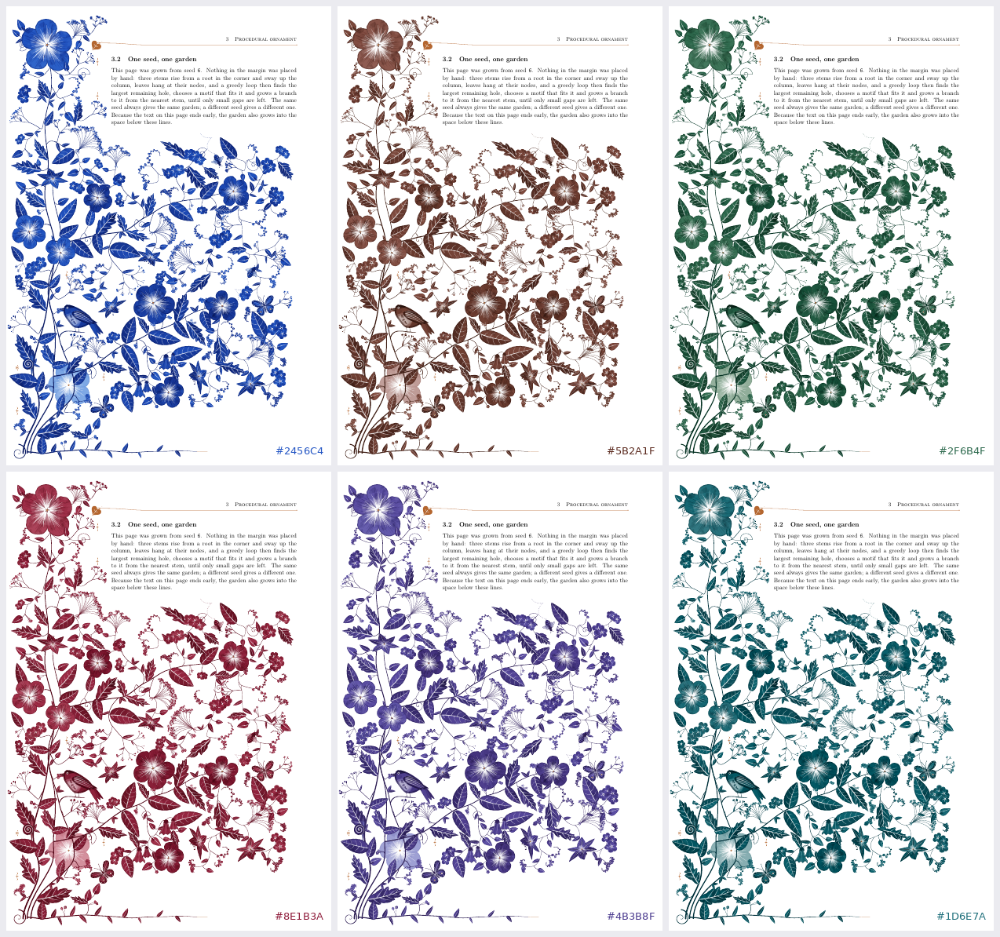
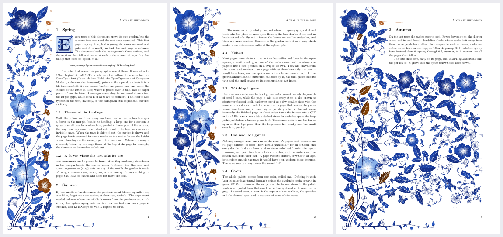
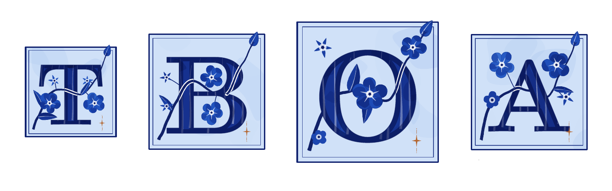
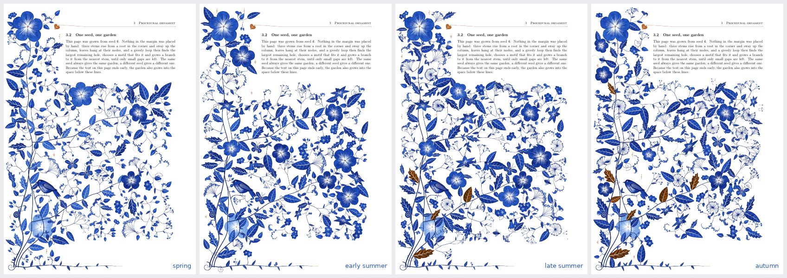
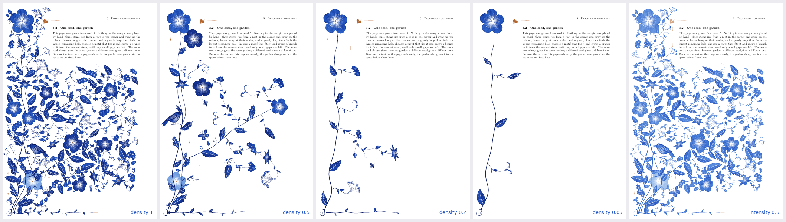
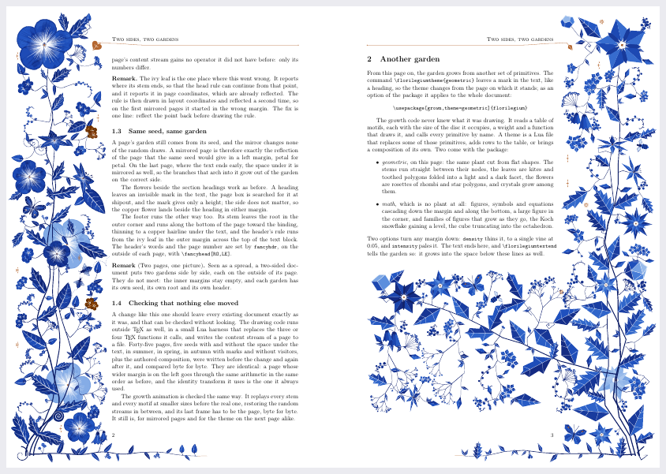
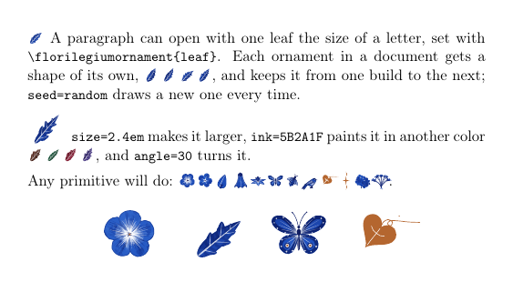

# Using the package

`florilegium.sty` needs LuaLaTeX and one run (two for the seasons). Put it and the
`florilegium*.lua` files beside your document, or install them all in one folder of your TeX
tree (for example `~/texmf/tex/latex/florilegium/`), where LuaLaTeX finds the Lua files too. On
[Overleaf](https://www.overleaf.com), upload them to the project and set the compiler to
LuaLaTeX.

For plants and visitors in a TikZ picture, under pdfLaTeX as well, see
[the TikZ library](tikz.md); it needs neither the package nor Lua.

## A first document

```latex
\documentclass{article}
\usepackage[a4paper,left=68mm,right=22mm]{geometry}   % a wide left margin for the garden
\usepackage[grown,sections]{florilegium}
\begin{document}
\section{Spring}
\florilegiuminitial[4]{T}his paragraph starts with a decorated T, and the margin beside it
grows a garden of its own.
\florilegiumtextend
\end{document}
```

`grown` grows the margin to fit each page, from plants sampled for the document (see [the
species garden](species.md)). Plain `\usepackage{florilegium}` draws the *authored* page
instead, a composition placed by hand and tuned for A4 with a 68 mm left margin, in v1.3's
hand-designed shapes.

## Options

| option | what it does |
|---|---|
| `grown` | the garden grown to fit the page; without it, the authored composition |
| `sections` | a flower beside every numbered section and subsection, in the copper of the accents (standard classes and KOMA-Script's; grown only) |
| `aging` | the garden ages from spring on the first page to autumn on the last (grown only; two runs, for the page count) |
| `novisitors` | no butterflies, bees, beetles, dragonflies, caterpillars, snails or birds |
| `theme=geometric`, `theme=math` | another drawing, or another composition (see [themes](themes.md)) |
| `density=0.4` | less in the margin, down to a single vine at `0.05` (grown only) |
| `intensity=0.6` | a paler margin, from `1` as painted to `0.3` faint |
| `nomargin` | no garden in the margin; ornaments, initials and `\florilegiumdraw` still work (for single pages, see [Pages without a margin](#pages-without-a-margin)) |

## Commands

| command | what it does |
|---|---|
| `\florilegiumtextend` | at the very end of the text, so that the garden also fills the space below it, in the same run |
| `\florilegiuminitial[5]{E}` | at the start of a paragraph, the letter as a decorated initial in a tile five lines tall (default 4) |
| `\florilegiuminitialfont{file.otf}` | the OpenType font the initial's outline is read from (default Latin Modern Bold) |
| `\florilegiumbloom`, `\florilegiumbloom[lily]` | a flower in the margin beside this line, or a bud, a leaf, a tendril, a role or a body plan on the page (grown only) |
| `\florilegiumage{0.8}` | the age of the pages from here on, from 0 (spring) through 0.5 (summer) to 1 (autumn) (grown only) |
| `\florilegiumtheme{geometric}` | another theme from the page this stands on (`flora` for none) |
| `\florilegiumoff`, `\florilegiumon` | no margin from the page this stands on, and the margin again |
| `\florilegiumhide`, `\florilegiumhide[1,3,5-8]` | no margin on the page this stands on, or on those pages of the PDF |
| `\florilegiumornament{leaf}` | one primitive in the line, the size of a letter |
| `\florilegiumdraw{flower}{1.2}` | one primitive at the origin of the current TikZ scope |
| `\florilegiumframe[explain]{k}{n}` | frame k of n of the garden's growth, for an animation (`animation.tex`) |

## Seeds

A page's garden comes from its page number, so page *n* gets the same garden on every build.
`\def\florilegiumseed{7}` before `\usepackage` picks another set for the whole document, and the
eight species its pages share. From the command line:

```sh
lualatex "\def\florilegiumseed{7}\input{florilegium-grow.tex}"
```

## Colors

The whole palette comes from one color, `ink`, and the hairlines and copper accents from a
second, `accent`. Define either after loading the package.

```latex
\definecolor{ink}{HTML}{5B2A1F}      % sepia instead of Delft blue
\definecolor{accent}{HTML}{B4662F}   % the copper
```



*One seed in six inks: Delft blue, sepia, green, crimson, violet, teal. The ramp from the
darkest stroke to the palest wash is computed from that hue in OKLCH, so the light end never
turns gray.*

## The margin reads the text



*`showcase.tex`, "A year in the margin": spring on the first page, summer, autumn on the last.
Each section describes the feature it shows.*

- **Initials.** The outline of the letter is read from an OpenType font and painted like a
  petal. A vine passes over and under its strokes in turn, with leaves where they fit and
  flowers in the gaps, often in the letter's counters. The letter is also typeset invisibly,
  so the paragraph still copies as "Every".
- **Flowers at the headings.** With `sections`, every numbered section and subsection gets a
  flower beside it in the copper of the accents, the way headings were once picked out in red.
- **A flower where the text asks.** `\florilegiumbloom` leaves a mark in the text. The marks
  are found in the page box when the page is shipped out, so this works in one run. A name
  that is no motif, role or plan on the page (a typo, `lilly`) draws nothing and says so in
  the log.
- **Seasons.** With `aging`, the garden ages from spring on the first page (buds, small pale
  leaves, fiddleheads) to autumn on the last (fruit and seed heads, falling petals, a few copper
  leaves). It needs two runs, for the page count; `\florilegiumage{0.8}` sets an age by hand.





*One seed in spring, early summer, late summer and autumn. The seasons change what grows, not
where.*

## Less in the margin



*Seed 6 at `density=1`, `0.5`, `0.2` and `0.05`, and at `intensity=0.5`.*

A full garden is a lot to have beside an equation. `density=0.4` grows less: the loop stops at
larger holes, keeps more paper around each motif, and hangs fewer leaves and fillers. Low on
the dial the plant itself thins out, to two main stems, then one, then no footer; at `0.05`
it is a single vine with its flower, a couple of leaves and one or two sprays. With the math
theme it means fewer things. `intensity=0.5` paints the whole margin paler, the way the ghost
flowers behind the garden are painted; it changes only the color, not the detail. At `1` and
`1` every page is the page it would have been without them.

## Pages without a margin

A title page or a page of figures may want no garden. `\florilegiumoff` stops the margin with the page it stands on, and `\florilegiumon` starts it again. In the preamble they apply from the first page.

```latex
\begin{document}
\florilegiumoff
\begin{titlepage} ... \end{titlepage}
\florilegiumon                 % after the page break, so the title page stays bare
\section{Introduction}
```

Both take effect on the page where they end up, as `\florilegiumtheme` does, so `\florilegiumon` goes after the `\newpage` or `\clearpage` that ends the last bare page. When a page holds several of them, the last one decides.

`\florilegiumhide` leaves out only the page it stands on. Inside a `figure` or a `table` that is the page the float lands on, wherever LaTeX puts it. `\florilegiumhide[1,3,5-8]` leaves out pages by number, anywhere before they are reached. The numbers count the pages of the PDF from 1, as a PDF viewer does, whatever the document prints at the foot, so roman front matter or a title page that starts the numbering again cannot be mistaken for another page.

A page without its margin changes nothing else. Its text is set the same, its initials and ornaments are still drawn, every other page keeps the garden it would have had, and with `aging` it still counts as a page of the year. The option `nomargin` leaves the margin out of the whole document, and `\florilegiumon` cannot bring it back.

## Both sides of the page



*`spread.tex`, pages 2 and 3: a two-sided document with a wide outer margin. The last page
also switches to the geometric theme.*

The garden grows in whichever side margin is wider, so there is nothing to set. In a
two-sided document (`twoside` with a wide outer margin) it changes sides with the page, and a
one-sided document with a wide right margin gets it on the right of every page. A mirrored page
is laid out as if seen in a mirror, then drawn through a reflection, the last transform every
point passes through, so it is exactly the reflection of the garden the same seed would grow
on the left.

## One ornament in the text



`\florilegiumornament{leaf}` sets one primitive in the line, in a box the size of a letter, for
example to open a paragraph. Each ornament in a document gets a shape of its own and keeps it
from one build to the next; `seed=random` draws a new one every time the PDF is built, and
`seed=7` a fixed one.

```latex
\usepackage[nomargin]{florilegium}       % ornaments only, no garden in the margin
\florilegiumornament{leaf} A paragraph that opens with a leaf.
\florilegiumornament[size=2.4em, ink=5B2A1F, angle=30, seed=random]{flower}
```

Any of v1.3's primitives works (`leaf`, `leaflet`, `flower`, `blossom`, `bud`, `bell`, `lily`,
`cyme`, `umbel`, `butterfly`, `bee`, `bird`, `hedera`, `sparkle`, ...), and so do the current
theme's (`crystal` with `geometric`; `knot`, `polyhedron`, `koch`, ... with `math`).

## Primitives in a TikZ picture

`\florilegiumdraw` draws one of v1.3's primitives inside a TikZ picture, under the current
scope's shift, rotation and scale. It is Lua, so it needs LuaLaTeX; for the species, use [the
TikZ library](tikz.md)'s pics.

```latex
\begin{tikzpicture}
  \begin{scope}[shift={(2,2)},rotate=20]\florilegiumdraw{flower}{1.3}\end{scope}
  \begin{scope}[shift={(5,0)}]\florilegiumdraw{leaf}{3.0, {depth=0.6}}\end{scope}
  \begin{scope}[shift={(8,1)}]\florilegiumdraw{ghost}{"lily", {s=1.4}}\end{scope}
  \begin{scope}[shift={(11,1)}]\florilegiumdraw{butterfly}{1.5}\end{scope}
\end{tikzpicture}
```

With a theme, its primitives can be drawn by name too: `\florilegiumdraw{crystal}{1.0}` under
`theme=geometric` (see `specimen-geometric.tex`), `\florilegiumdraw{knot}{1.2}` under
`theme=math`.
