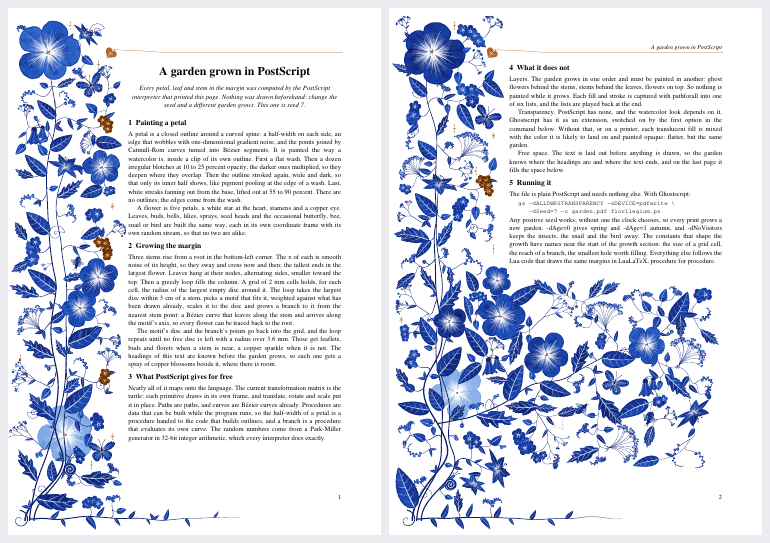

# florilegium in PostScript



`florilegium.ps` grows florilegium's margin garden in PostScript, the language many printers
speak. It is one self-contained file. The interpreter that runs it, Ghostscript or a printer,
computes every petal, leaf and stem from a seed while it reads the page, and typesets two
pages of text that explain how. It ports `ink.lua`, `flora.lua` and `grow.lua` (the drawing
core, the primitives and the growth loop that LuaLaTeX runs) procedure for procedure.

## Running it

Ghostscript turns it into a PDF or into images:

```sh
gs -dALLOWPSTRANSPARENCY -dSeed=7 -sDEVICE=pdfwrite -o garden.pdf florilegium.ps
gs -dALLOWPSTRANSPARENCY -dSeed=7 -sDEVICE=png16m -r100 -dGraphicsAlphaBits=4 -o page-%d.png florilegium.ps
make postscript SEED=7      # from the repository root: build/postscript-7.pdf and the preview above
```

Two pages take about 2.5 seconds. These options change the garden:

| option | what it does |
|---|---|
| `-dSeed=N` | Picks the garden. Seeds run from 1 to 250000, and a larger one wraps around. Without a seed the clock picks one. |
| `-dAge=x` | Sets the season, from 0 (spring) through 0.5 (summer, the default) to 1 (autumn). |
| `-dNoVisitors` | Leaves out the butterflies, bees, snail and bird. |
| `-dALLOWPSTRANSPARENCY` | Lets Ghostscript paint the washes translucent. PostScript itself has no transparency, so without this option each translucent fill is mixed with the color it is likely to land on and painted opaque, as on a printer. The result is flatter, but it's the same garden. |
| `-dFloCheck` | Writes a checksum of everything each page paints to stderr, for `check.sh`. |

Ghostscript reads `-dSeed=7` as a number, a bare `-dSeed` as `true` and `-sSeed=7` as a
string. The file accepts all three. A number or a string of digits is the seed, and anything
else counts as no seed. `-dAge` works the same way, and `-dNoVisitors=false` or
`-dNoVisitors=0` keep the visitors.

A printer takes no options. To print a chosen garden, add a line that sets the seed right
after the first line of the file (the first line, `%!PS`, is how a printer knows the file is
PostScript):

```sh
{ head -1 florilegium.ps; echo '/Seed 7 def'; tail -n +2 florilegium.ps; } | lp
```

Plain `lp florilegium.ps` grows a new garden for each print.

## How the seed is chosen

Every garden comes from one number. Page 1 grows from the seed and page 2 from the seed plus
7907. Within a page, the layout, the visitors and the season each draw from a stream of
their own, started from the page's seed times 7919 plus a small constant. The generator is
Park and Miller's "minimal standard" generator (multiply by 16807, modulo 2³¹ − 1), computed
by Schrage's method so that no product leaves 32-bit integers. It isn't the generator the Lua
uses (mulberry32), and PostScript reals are single precision, so seed 7 here grows a
different garden from seed 7 in LaTeX.

**The clock.** Without a seed, the file asks the interpreter what time it is. PostScript has
two clocks, and they're easy to confuse. `realtime` counts milliseconds from an origin each
interpreter chooses, and Ghostscript chooses its own start, so by the time the file asks it
reads about 20. A reader pointed out that getting the time out of a PostScript interpreter is
notoriously hard, and for `realtime` they were right. Until 1 November 2026 the file seeded
from it, and twelve runs in a row gave seed 20 seven times and only five gardens in all.

The other clock is the `%Calendar%` device of PostScript Level 2, which gives the year,
month, day, hour, minute and second (`(%Calendar%) currentdevparams`). Ghostscript has it,
also under `-dSAFER`, and reads local time. The file now turns those six numbers into a seed
from 1 to 99991, so each second grows a different garden, and two prints started in the same
second grow the same one. The seed is printed under the title, so any garden can be grown
again with `-dSeed`. An interpreter without a calendar, or whose calendar isn't running,
falls back to `realtime`.

**The range.** The PostScript reference gives integers 32 bits, and an integer operation
that overflows gives a real instead, which keeps only 24 bits of precision. Above a seed of
about 263000, page 2's seed times 7919 would overflow, and an interpreter with 32-bit
integers would grow a different garden from Ghostscript, whose integers are 64 bits wide.
So seeds stay at or below 250000, where every page fits, and a larger seed wraps around
(250001 grows the garden of 1).

## How the Lua maps onto PostScript

Most of it maps directly. PostScript's own transformation matrix places each primitive
(translate, rotate, scale), paths and Bézier curves are native, and procedures built at run
time stand in for Lua's closures (a petal's half-width is a procedure handed to the outline
builder). These parts needed more work, and are worth knowing before changing the file or
porting it again:

- **Layers.** The garden grows in one order but is painted back to front: ghost flowers,
  stems, leaves, airy sprays, blooms, then copper accents. So nothing is painted while it
  grows. `ifill`, `istroke` and `iclip` capture each path with `pathforall` into numbered
  layers, and `paintlayers` plays them back at the end.
- **Transparency.** Translucent washes need Ghostscript's extension (see the options). On
  any other interpreter, `mixed` works out the opaque color a wash would make over the last
  opaque color painted.
- **Names.** PostScript looks names up at run time in a stack of dictionaries, so a procedure
  handed to a helper sees the helper's variables before its caller's. Helpers that take a
  procedure keep their own names under an underscore (`_p`, `_n`), and the growth helpers use
  prefixes (`d.` for the free disc, `a.` for adding a stem).
- **Angles** are degrees in PostScript (`sin`, `cos`, `atan`), radians in the Lua.
- **Literal arrays** in a procedure body are made once, when the file is read, and every call
  shares them. A procedure that changes an array builds a fresh one first.
- **Text.** The file typesets its own two pages in Times. It lays out the text before it draws
  anything, so it knows where the headings are (each gets a spray of copper blossoms) and
  where the text ends (on the last page the garden fills the space below).

The port has the grown margin of `grow.lua` with all its primitives, the seasons, the
visitors, the heading marks, the garden under the last line and the ivy-leaf head rule. It
has no animation, initials, themes, mirrored pages, density or intensity, ornaments in the
text, or authored composition. Nothing keeps it in step with the Lua: a change to a primitive
or to `grow.lua` has to be made here as well, by hand.

## Ghostscript notes

These held for Ghostscript 10.05.

- The transparency operators (`.setfillconstantalpha`, `.setblendmode`) exist only with
  `-dALLOWPSTRANSPARENCY`, and a raster device also needs `0 .pushpdf14devicefilter` on each
  page.
- A `stroke` takes the fill alpha when rasterized and the stroke alpha when written to a PDF,
  so the file sets both.
- A raster page that is drawn in bands while the transparency compositor is pushed crashes
  Ghostscript on the second page. `/MaxBitmap` in `setpagedevice` keeps the page in one piece.
- Adobe's `ISOLatin1Encoding` has `/minus` at position 45, not `/hyphen`.
- `realtime` and `usertime` count from the interpreter's start. `%Calendar%` reads local time
  and follows `TZ`.
- `pathforall` returns coordinates rounded to the device's pixel grid, so the drawing checksum
  of `-dFloCheck` depends on the device and its resolution. `check.sh` always uses the null
  device at 72 dpi.
- The file reads and writes no files (only stderr), so it runs under `-dSAFER`, which has been
  the default since Ghostscript 9.50.

## Tests

`check.sh` runs the file through Ghostscript about forty times at once and checks five
things:

1. Ten pages grow and paint what `expected.txt` records. They cover seeds 1, 7, 12, 99991 and
   250000, spring and autumn, no visitors, and pages with and without transparency. For each
   page the record holds the number of grid cells, motifs, stem points and visitors, and a
   checksum of every path, color and line width the page paints.
2. Every way of writing an option draws the page it should. `-dSeed=7`, `-dSeed=-7`,
   `-dSeed=7.9`, `-dSeed=250007`, `-sSeed=7` and `/Seed 7 def` in the file all grow one
   garden. A bare `-dAge` is summer, `-dAge=5` is autumn, `-dNoVisitors=1` and
   `-dNoVisitors=true` leave the visitors out, and `=0` and `=false` don't.
3. Without a seed, the seed comes from the second each run started in, and without a calendar
   (or with a stopped one) the file falls back to `realtime`.
4. The largest seeds keep every page within 32-bit integers.
5. The PDF has two pages, both pages render at 300 dpi with transparency, and one seed
   rendered twice gives the same pixels.

```sh
postscript/check.sh                     # from the repository root, with the gs on the PATH
GS=/path/to/gs postscript/check.sh      # another Ghostscript
postscript/check.sh --record            # rewrite expected.txt after an intended change
```

It takes about 10 seconds on a 32-core machine, and longer with fewer cores. After an
intended change to the drawing, record the new pages and look at a few before committing
them. The checksums can change between Ghostscript versions even when the garden doesn't, so
when `expected.txt` was recorded with a different version, a page that grows the same
garden but paints a different checksum gives a warning, not a failure.

On 1 November 2026, with Ghostscript 10.05.1 on Linux, all twelve checks passed. Each check
was also seen to fail when it should. A head-rule dot made 0.1 mm wider changed every
checksum. A 2.1 mm grid instead of 2 mm changed every garden. The old `realtime` seed gave
seeds 35 and 21 where the times called for 37458 and up.

`check.sh` can't run a printer's own interpreter or any interpreter but Ghostscript, and it
can't tell whether the garden still looks right. To check that, render a page and look at it.

## Files

| file | what |
|---|---|
| `florilegium.ps` | The program, with its license inside. It travels alone, so it needs nothing else here. |
| `check.sh` | The tests. |
| `expected.txt` | What the tests expect, recorded by `check.sh --record`. |

## Credits

- The random numbers come from the "minimal standard" generator of S. K. Park and K. W.
  Miller, *Random number generators: good ones are hard to find*, Communications of the ACM
  31(10), 1988, computed by the method of L. Schrage, *A more portable Fortran random number
  generator*, ACM Transactions on Mathematical Software 5(2), 1979.
- `realtime` and the `%Calendar%` device are described in Adobe's *PostScript Language
  Reference*, third edition (1999).
- The growth loop follows Wong, Zongker and Salesin, *Computer-Generated Floral Ornament*
  (SIGGRAPH 1998), as the Lua does.
