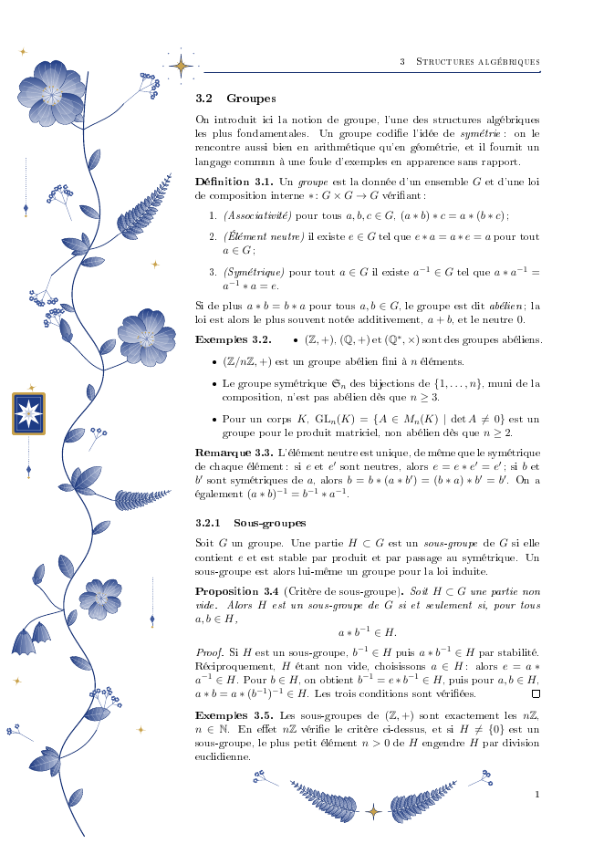
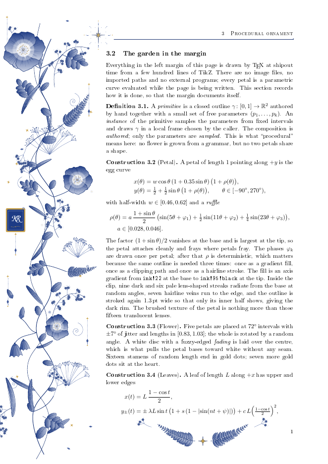
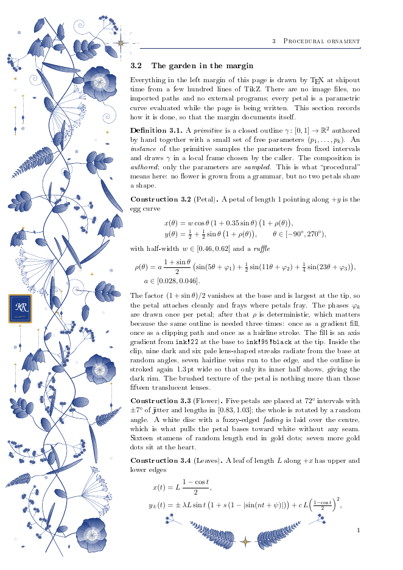

[Process](../PROCESS.md) · [Part 2 · Claude Code →](claude-code.md)

# Part 1 · Claude.ai

> [!NOTE]
> I used Fable 5.1 on Extra effort for the entire session. The way the UI works is Claude will sometimes inject the specific step it's working on, like a web search or running a command, but these steps are not automatically copied when using the copy button. I didn't try to capture all those detailed steps for this document.

**Kevin**

Here's a fun one - I haven't used LaTeX much at all, but I'm positive you know about it. How can we achieve something like this and share it?

Reddit quote:

For context**:** I know for a fact these flowers are procedurally generated purely in TikZ with no external assets. I know about l systems but this is way too elaborate. The creator prefers to keep the source closed to avoid code critiques(in spite of my supplications) so I'm stuck having to reverseengineer how to achieve this level of flower quality ?

Image attached.

*(The image from the [Reddit post](https://www.reddit.com/r/LaTeX/comments/1xixznw/how_do_you_make_these_flowers_in_latex/) was pasted here. It isn't reproduced in this repo.)*

**Claude**

I'll check what LaTeX tooling is available here, then build a working demo of the technique.

No babel-french here, so I'll hand-space the French punctuation. Writing the source now.

The sed ate the backslash. Fixing the first line properly.

`\fi` as a loop variable — that's the TeX primitive. Renaming.

pgfmath arithmetic lives in TeX dimensions (max ≈16383), so the page-2 seed overflowed. Smaller multiplier.

Both pages render, each with its own jitter. Let me check the fine detail at print resolution before sending.

Detail holds up at 300 dpi. Packaging it as a shareable repo skeleton (README + GitHub Actions build) and sending the files.

Built from scratch and verified: `florilegium.tex` compiles with plain pdflatex (~10 s/page), no assets, and reproduces the look — gradient-shaded notched petals with veins, tapering ferns, baby's-breath sprays, bells, buds, pendants, the framed star emblem, the header sparkle, and a footer flourish.

**How the "flower quality" actually happens**

The Reddit poster's framing is the trap. "Procedurally generated" doesn't mean an L-system grew the flowers. It means a handful of *authored* primitives (petal, leaf, bell) get *procedural* placement and jitter. Once you see it that way it's an afternoon, not a research project. The pieces:

- **Bézier primitives with jitter.** A petal is one closed cubic path; four control values get `rand` perturbations, so no two petals match. That's what kills the "rubber stamp" look.
- **Layering per primitive, 3–4 passes.** Axis gradient fill (`top color`/`bottom color`/`middle color` from the `shadings` library), a translucent white inner wash, white veins *clipped* to the outline, then a 0.3 pt hairline stroke. The gradient rotates with the petal's local frame, so a rotated scope just works.
- **Markings along paths.** `decorations.markings` with `mark=between positions … with {\leaf}` hangs leaflets along a curved rib, oriented to the tangent; `mark info/sequence number` tapers them. Same trick hangs leaves on the main vine and drops named coordinates for side branches.
- **A recursive macro for the sprays.** Ternary branching, random angle/length, dot clusters at the terminals. (TikZ does ship a `lindenmayersystems` library, but it only draws line segments; the recursion gives you control at the tips.)
- **One hue, many tints, one accent.** `ink!30` … `ink!95!black` plus gold. Palette discipline does half the work.
- **Per-page determinism.** `\pgfmathsetseed{\value{page}*97+1030}` inside the `eso-pic` background hook — every page gets its own garden, identical on every compile.

Two gotchas I hit that'll save you time: pgfmath does arithmetic in TeX dimensions, so integers must stay under 16 384 (my first seed overflowed on page 2); and `\foreach \fi` silently breaks everything because `\fi` is a primitive.

**Sharing**

- **Overleaf** — paste the one file into a blank project, share the link. Zero friction for non-LaTeX people.
- **GitHub** — the zip is a repo skeleton: README, `.gitignore`, and an Actions workflow (`xu-cheng/latex-action`) that builds the PDF on push and attaches it to tagged releases.
- **As a package** — move the primitives into `florilegium.sty` so others `\usepackage` it; CTAN if you want the full public route.
- **As standalone art** — wrap `\margingarden` in `\documentclass{standalone}` and run `dvisvgm --pdf` for SVG, or `pdftoppm` for PNG, for use outside LaTeX.

If the generation logic outgrows TeX macros (noise fields, stochastic L-systems, real geometry), the sane escape hatch is LuaLaTeX: write the generator in Lua inside `\directlua`, `tex.print` the TikZ paths, keep the drawing layer unchanged. For you that'd probably be the more natural home than pgfmath.

*(Claude attached a two-page demo and its single-file TikZ source to this reply. They follow the
original page too closely to publish here, so only a preview of the first page is shown.)*

> [!NOTE]
> This is the "exactly where Claude started" that I mentioned in the main process file. Claude started building without any discussion, using only my first message and limited context/input. This is what leads to the "AI slop" - you can't stop here. It copied the look, the boxed star, and even made it with French text.

**Kevin**

Excellent. Can you make it more intricate, like the original shown? Not a copy, but with that level of extra detail? And change that star in the box to something else ... maybe a "KR" or another fancy symbol. Here's a zoomed in image to show the extra detail at the top. If we can make it even better than this - nice.

*(A zoomed-in crop of the Reddit image, showing the detail at the top, was pasted here. It isn't reproduced in this repo.)*

> [!NOTE]
> My initial pushback against making a replica. Without guidance, these tools will make what they know.

**Claude**

The zoomed crop makes clear what the extra fidelity consists of: ruffled petal edges with a brushed/mottled texture, deeply dissected serrated leaves, long grass blades, sprays whose terminals are tiny florets rather than dots, an umbel (Queen Anne's lace), tendrils, and a scatter of small ornaments. I'll rebuild the primitives around those. Checking two things first: whether TikZ here supports reusing a computed path (saves recomputing the ruffles three times) and which script fonts exist for the monogram.

*(Claude started background tasks here, and I interrupted it with my next request.)*

**Kevin**

Ooo! And instead of the sample PDF showing whatever that French stuff is, maybe we have it describe the flowers in a different way? Does that make sense? Also, here's the rest of the comments, with various offered solutions ... I like this ours here so far - it seems to be working - but does any of this lead you in a different direction?

*(The comments from the Reddit post were attached here, so Claude could weigh the solutions people offered. They aren't reproduced in this repo.)*

**Claude**

Right — TikZ reads a coordinate up to the first `)`, so any expression with its own parentheses must be wrapped in braces: `({sin(\sa)},{...})`. Fixing the test.

All three pages render cleanly. Updating the README for v2, repackaging, and sending.

Yes, it made sense, and it's done: the document now describes its own margin. Definitions, Constructions (with the actual petal and leaf equations), a Remark on why procedural ≠ random, a Proposition on compile cost, an Exercise pointing at the next step, and a closing section on building and sharing. Still pdflatex, still one file, still zero assets. Monogram plaque is now a Zapf Chancery **KR**.

**What changed to get the intricacy**

- **Petals** are now a parametric egg curve multiplied by a ruffle: three sines at incommensurate frequencies with per-petal random phases, weighted to vanish at the base. Because the phases are fixed once, the outline is deterministic, so it's computed once and reused for fill, clip and stroke via `save path`/`use path`. Inside the clip: nine dark and six pale lens-shaped streaks radiating from the base (that's the entire "brushed" texture), seven hairline veins, and the outline restroked 1.3 pt wide so only its inner half shows — the dark rim.
- **Leaves** are two parametric plots (upper/lower edge) joined at a pointed tip, with width, serration depth, tooth count and curl as parameters. Same macro gives serrated leaflets and grass blades. A dissected leaf is a rib carrying three pairs of leaflets plus a terminal one.
- New: **florets** (real five-petal flowers 2 mm across) at spray tips, **arch sprays** (long bent stalk with sprays hung along it), **umbels** (Queen Anne's lace, 11 rays each ending in a 6-ray secondary umbel), **tendrils** (log spirals), a second **companion stalk** that crosses the vine, an **eight-ray star** with gold→ink radial shading, and five small **ornaments** scattered at random.

Cost: ~35 s/page now vs ~10 s. v1 is in the zip as the lighter starting point.

**The thread**

Most of it is noise — "background image", "export from Inkscape", "ask Claude to convert an SVG" all abandon the premise, and the L-system suggestion is a dead end because TikZ's `lindenmayersystems` only emits line segments. The one comment that matters is [a commenter]'s pointer to **Wong, Zongker & Salesin, *Computer-Generated Floral Ornament* (SIGGRAPH 1998)**. That paper is the piece we don't have. Our composition is authored: I placed the anchors by hand and let the parameters vary. Their algorithm places elements by growth — find the largest free region adjacent to existing ornament, pick a motif that fits, repeat until nothing fits. That's exactly what the OP keeps describing about the friend's version ("adapts the pattern to fit the unused space", "would generate a flower pattern for any document formatting"), and the Langton/artificial-life remark fits a growth process too.

So the fork is this: the primitives we have are the hard, visual part and they're done; the adaptive layout is a second stage that sits on top of them. It needs geometry bookkeeping (occupied-disc tests, a free-space search) that pgfmath is a miserable host for, which is where LuaLaTeX comes in — layout in Lua, drawing unchanged. Overleaf runs LuaLaTeX fine, so sharing doesn't suffer. I'd call that the "even better than this" step, and I'd do it as a separate `florilegium-grow.tex` so the pure-pdflatex version stays as the entry point. Want me to build it?

*(Claude attached [the three-page document](claude-ai/response-3/florilegium.pdf) and
[its source](claude-ai/response-3/florilegium.tex) to this reply.)*

> [!NOTE]
> Here is where we find some additional information, both about prior art for procedurally generated florals, and LuaLaTeX. Lua I've poked around with a little before (ArduDrone) so this sounds promising for speed. It's important to actually read what the AI is spewing back to you, especially if the topic is something you're not familiar with.

**Kevin**

Yes, let's do that. My main goal is to make a small repo that shows all this, show the florals re-generating differently each time, etc., then I'll share the repo. If a CC [Claude Code] handoff pack is easier, that's cool.

Changing the text to the methods used is perfect - thanks.

**Claude**

*(These came back as separate messages while Claude waited on its builds.)*

Good — the growth stage it is. Plan for the repo:

- `florilegium.sty` — primitives shared by both documents
- `florilegium.tex` — authored composition, pdflatex (what you have now)
- `florilegium-grow.tex` + `grow.lua` — grown composition, lualatex; layout computed in Lua in the Wong–Zongker–Salesin spirit, drawing left to the same primitives; the garden also spills into empty space below the text on the last page
- `make gallery` — renders N seeds, builds a contact sheet and a GIF for the README
- `CLAUDE.md` handoff, README, MIT license, CI

Checking two capabilities first: `zref-savepos` (to find where the text ends) and PGF's `luamath` library (pgfmath evaluated in Lua — could cut compile time a lot).

Package build is identical to before. Now the growth engine.

First pass compiles: 4 pages, ~118 motifs placed per page. Looking at the result before the second pass adds the spill.

Two cores, so those builds will take a while. Writing the repo plumbing and docs in the meantime.

The builds are running (two cores, roughly 20 minutes of work). I'll wait for the completion notification rather than poll.

Status: the growth stage works. `grow.lua` lays a vine, then greedily fills the largest free hole with the largest motif that fits, attaches it to the nearest thing already drawn, and repeats — and on a short last page the region includes the space below the text, so the garden spills across it (that's the "adapts to unused space" behaviour from the thread). The six-seed gallery and the full grown document are compiling now (~20 min on this box's two cores); repo scaffolding (package, Makefile, CI, README, CLAUDE.md, MIT) is written. I'll send the bundle when the renders are in.

Waiting on the builds.

---

Second pass of the grown document has started (its log reset). Still waiting.

---

Still building; waiting.

---

The grown document finished both passes. Checking its last page for the spill while the gallery finishes.

Waiting for the gallery to finish before rebuilding.

---

Three of six seeds rendered. Still waiting.

---

Still three of six; the remaining seeds are mid-compile.

---

Six distinct gardens — the regeneration demo is in hand. Rebuilding both documents with the corrected sharing text, then packaging.

Old monitor stopped; the rebuild (background task) will notify on completion. Waiting.

---

Done. `florilegium-repo.zip` is a ready-to-push repository: unzip, `git remote add origin …`, push. One commit, MIT, CI, both PDFs and the gallery committed so the GitHub page shows everything without a build.

**What's in it**

- `florilegium.sty` — all primitives plus the authored composition, now geometry-aware (reads the page layout) with an overridable seed. Any engine.
- `grow.lua` + `[grown]` option — the growth stage. Vine → candidate grid → greedy loop: largest free disc within reach of something drawn, largest motif that fits, oriented away from its anchor, stem attached, repeat down to ornament size. Per-kind caps scale with region area. On the last page the free region includes the space below the text (`zref-savepos`, hence two passes), with one wavy branch per ~7 cm of it.
- `florilegium.tex` (authored, pdflatex) and `florilegium-grow.tex` (grown, lualatex) — both self-describing; the grown one adds a section with the growth definition, construction and cost.
- `make seed-7`, `make gallery SEEDS="1 2 3"` — `tools/gallery.py` renders seeds into `gallery/seeds.png` + `seeds.gif`. That GIF is the top of the README.
- `CLAUDE.md` — the handoff: file map, build commands with timings, the traps that cost time (brace parenthesised coordinates, `\fi` as a loop var, pgfmath's 16 384 ceiling, luamath conflicting with markings), how growth works, how to add a motif, and a not-done list.

**Two things to know before you share**

Compile times are honest but not small: ~35 s/page authored, ~60 s/page grown, ~3.5 min for a gallery page with a big spill. The README says so. The fix is in CLAUDE.md's ideas list — emit the petal/leaf sample points from Lua instead of pgfmath — and would cut it several-fold, but it changes the "pure TikZ primitives" story, so I left it as a documented next step rather than doing it.

The documents pin Computer Modern under LuaLaTeX because this container lacks luaotfload's font database. On a normal TeX Live that line is harmless; delete it if you'd rather have Latin Modern.

If you push it and want the gallery regenerated in CI, the `gallery` job is `workflow_dispatch` only — on purpose, since it's ~15 minutes of runner time.

*(This was the last message in the Claude.ai chat. Claude attached
[the grown document](claude-ai/response-final/florilegium-grow.pdf) and
[`florilegium-repo.zip`](claude-ai/response-final/florilegium-repo.zip), which I used to
start the repo in Claude Code.)*

> [!NOTE]
> This zip was the whole repo at the end of the browser session, with one commit. This is the first time I've seen Claude actually include the .git directory with a commit. I always ask for a handoff pack, which is just what I call the archive of stuff to move over to a directory I already have waiting, and that has always been just directory structure, MD files, specs, etc. This specific commit is not in my repo because I asked CC for a fresh "Initial commit" (part 2).

[Part 2 · Claude Code →](claude-code.md)
